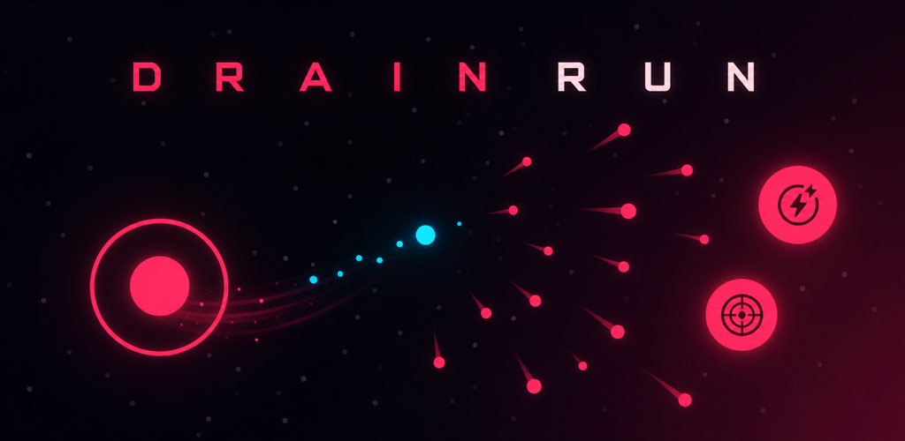
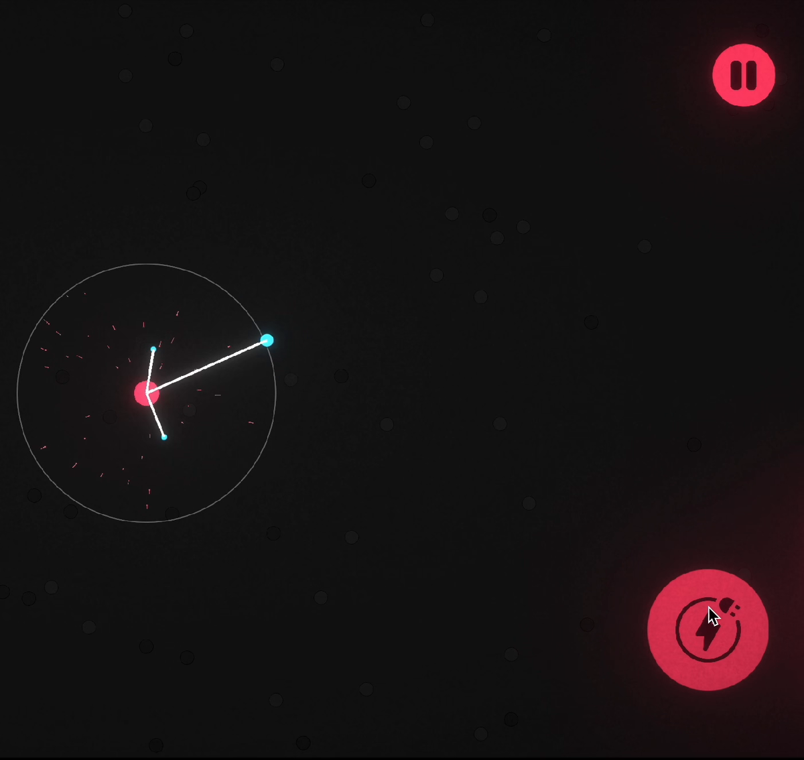
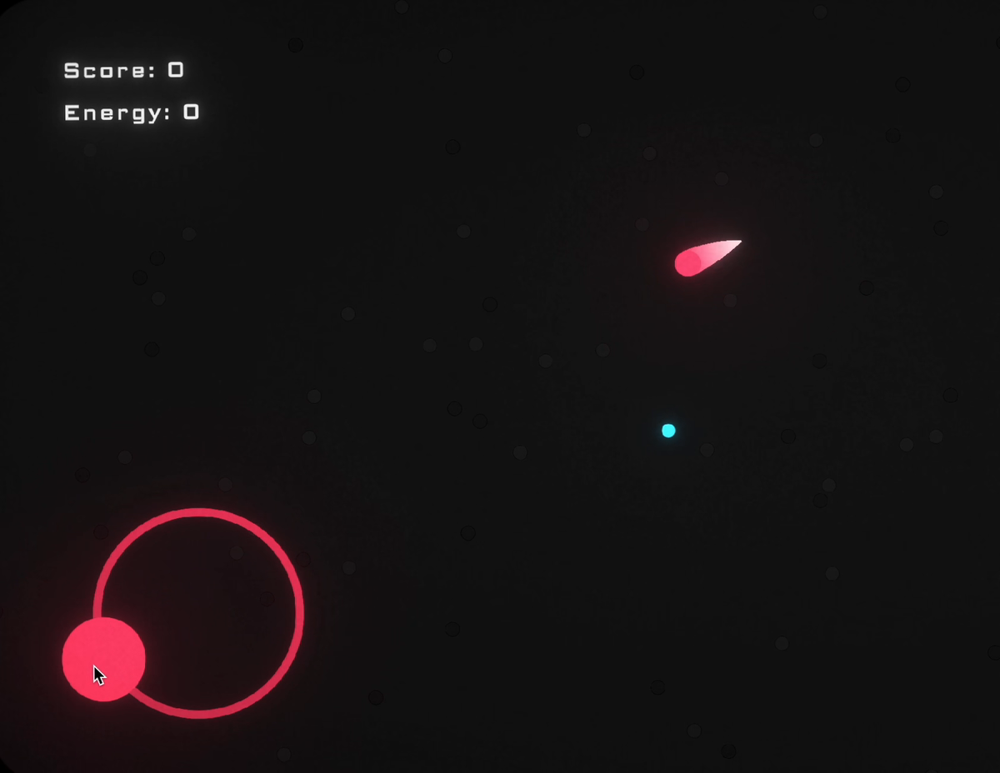

# Drain Run — website project content

Everything below is ready to paste. Images live in `Portfolio/images/`.

---

## Card (for the project grid)

**Image:** `images/drain-run-cover.png` (1024×500)

**Title:** Drain Run

**One-liner:** A neon arena shooter for Android where your only ammo is the energy you steal from the battlefield.

**Tags:** Unity 6 · C# · Android · Game Design · URP 2D

---

## Project page



### Drain Run
*Neon top-down survival shooter · Android · Dec 2025 – present*

**Role:** Solo developer: game design, gameplay programming, UI/VFX, Android release pipeline
**Status:** v1.8 in Google Play closed testing
**Built with:** Unity 6 (URP 2D), C#, Unity Input System, TextMesh Pro, Android SDK

#### Overview

Drain Run is a fast mobile arena shooter built around one tension: **you can't shoot without draining, and you can't drain safely.** Ammo is scarce. To refill it, you hold the Drain button to pull energy out of the cyan orbs drifting around the arena. While you drain, you move slower and a heat gauge climbs. Push it too far and you overheat, which locks draining for three seconds while enemies close in. One hit ends the run.

#### How it plays

- **Move** with a virtual joystick. **Fire** with hold-to-shoot auto-targeting.
- **Drain** energy orbs inside your radius. Every 2 energy drained gives you +1 ammo.
- **Manage heat.** The Drain Heat gauge shifts from green to amber to red, then shows an OVERHEATED countdown.
- **Survive endless waves** of three enemy types, each with its own shape and attack:
  - **Chaser** (circle): rushes straight at you.
  - **Dasher** (triangle): telegraphs a lunge with a red ring and a direction line, then dashes.
  - **Shooter** (square): holds its distance, shows an aim line, then fires tracer rounds.
- **Choose a power-up** after every cleared wave, picking one of three cards:
  - *Common, stackable:* Rapid Fire, Power Rounds, Kinetic Drives, Thermal Vent
  - *Rare abilities:* Twin Shot, Piercing Shot, Overheat Nova (overheating releases a shockwave)
- **Chain kills** for a streak multiplier: x2 at 3 kills, x3 at 8, x4 at 15. Leave more than 2.5 seconds between kills and the streak breaks.



#### What I built

- **Wave director.** Endless waves open with chasers only, then bring in dashers and shooters gradually. The spawn ring tightens from 12 units to 7 as waves go on. Between waves there are three-second intermissions, animated wave titles and camera zooms.
- **Risk/reward resource loop.** Ammo, energy and drain heat feed into each other, so every fight comes down to whether you can afford to drain right now.
- **Readable combat.** Each enemy has its own silhouette and a wind-up telegraph before it attacks, so every death is readable and feels fair on a small phone screen.
- **Game feel.** Hit-stop, screen shake, recoil kick, hit flashes and spark bursts, score popups, kill-streak tier pulses, wave-clear reward rings, and short Android haptics through JNI with amplitude control.
- **Procedural neon UI.** The power-up cards, icons and glow materials are generated entirely in code, with no image files. The cards animate their own entrance, the rare-card light sweep, and the chosen/dimmed states.
- **Procedural sound effects** for shooting, hits, empty-ammo clicks and rewards.
- **Self-wiring systems.** Feedback, kill streak and HUD elements create and attach themselves at startup, so there's nothing to wire up in the scene.
- **Release tooling.** Editor scripts build a signed Play Store AAB or a device APK with one command. A batch-mode renderer turns the power-up card screen into a PNG without opening Play mode.
- **Playtest-driven iteration.** I shipped 8+ closed-test builds and kept a prioritized checklist from tester feedback covering onboarding, combat readability, fair openings and restart flow.



#### What I learned

Designing around a single, deliberate weakness (draining slows you down) produced more interesting decisions than adding more weapons. On mobile, readability is gameplay: distinct shapes, attack telegraphs and clear heat feedback did more for perceived fairness than any balance tweak.

**Links:** [Google Play (closed testing)](#) · [GitHub](#)

---

## Image list

| File | Use it for | Alt text |
|---|---|---|
| `images/drain-run-cover.png` | Card thumbnail / page hero (1024×500) | Drain Run title art: a glowing player orb dodging a spray of red projectiles |
| `images/drain-run-icon.png` | Small square thumbnail / app icon (512×512) | Drain Run app icon: a cyan core surrounded by incoming red projectiles |
| `images/drain-run-shapes-art.png` | Alternate square art (512×512) | Geometric art showing the player and the circle, triangle and square enemy shapes |
| `images/drain-run-logo.png` / `.svg` | Header / logo strip | Drain Run logo |
| `images/gameplay-drain.mp4` (+ `.gif`, `-still.png`) | Gameplay clip: draining | Player draining energy orbs with beams inside the drain radius |
| `images/gameplay-movement.mp4` (+ `.gif`, `-still.png`) | Gameplay clip: movement | Player moving with the virtual joystick while enemy shots fly past |

The MP4s are about 150 KB each and the GIFs about 3 MB. Use the MP4s where your site allows it:

```html
<video src="images/gameplay-drain.mp4" poster="images/gameplay-drain-still.png"
       autoplay muted loop playsinline width="720"></video>
```
